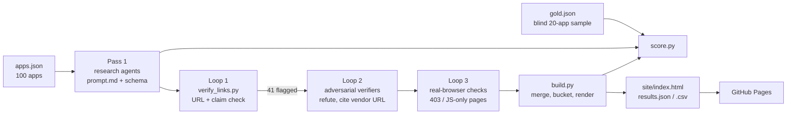

# 100-App Toolkit Audit

Last updated: 2026-11-23 10:22 AM CST

[](https://github.com/Atharva1399/100-App-Toolkit/actions/workflows/pages.yml)

**Live page: https://atharva1399.github.io/100-App-Toolkit/**

By **Atharva Gaikwad** ([@Atharva1399](https://github.com/Atharva1399)).

Which of 100 SaaS apps can an AI agent platform turn into a toolkit today? For every app this project
records its category, auth methods, how a developer gets credentials (self-serve vs gated), API surface,
MCP availability, a buildability verdict with the main blocker, and an evidence URL behind each answer.
It then finds the patterns across all 100 and proves how accurate the data is.

The project has two parts:

1. **The research agent** (`agent/`): a Python pipeline that researches each app, verifies the answers
   in three loops, scores accuracy on a blind sample, and builds the page.
2. **The case-study page** (`site/index.html`): one self-contained HTML file with the findings, patterns,
   charts, verification results and the full 100-row table. It is deployed to GitHub Pages.

## Contents
- [Headline results](#headline-results)
- [How it works](#how-it-works)
- [Repository layout](#repository-layout)
- [Run it locally](#run-it-locally)
- [Deploy the page](#deploy-the-page)
- [Verification method](#verification-method)
- [Where a human was needed](#where-a-human-was-needed)
- [Troubleshooting](#troubleshooting)
- [Known limitations](#known-limitations)

## Headline results

| Metric | Value |
|---|---|
| Ready to build today | **59** / 100 |
| Ready with friction (paid plan, app review, narrow API) | 30 |
| Blocked (sales/partner gate or no hosted API) | 11 |
| Support OAuth2 / also offer a static key or token | 78 / 62 |
| Vendors with an official MCP server | 83 |
| Non-ready apps blocked by a human gate (review or sales) | 22 of 41 |
| Accuracy on blind 20-app sample: first pass → after verification | **91.2% → 98.8%** |

Numbers are generated from `data/` by `agent/build.py`; the page and `data/metrics.json` are the source of truth.

<sub>[↑ Back to contents](#contents)</sub>

## How it works



1. **Spec**: `agent/prompt.md` fixes the method and vocabulary (6 access tiers, 3 verdicts) so 100
   answers are comparable and machine-checkable. `agent/schema.py` validates every record.
2. **Pass 1**: research agents (web search + fetch, vendor docs first) emit one JSON record per app with
   evidence URLs and a confidence level. `agent/research.py` is the headless version (LLM API).
3. **Loop 1**: `agent/verify_links.py` fetches every evidence URL and checks it resolves and that the
   page mentions the claimed auth method / MCP. Deterministic, no LLM.
4. **Loop 2**: flagged records go to independent verifier agents told to *refute* each field and cite a
   vendor URL for every change.
5. **Loop 3**: pages automated fetchers cannot load (HTTP 403, JS-rendered docs) are checked in a real
   browser; rows that stay ambiguous keep a `needs_human` badge.
6. **Score + build**: `agent/score.py` measures per-field accuracy on the blind sample; `agent/build.py`
   merges the loops, buckets blockers, and renders the page plus JSON/CSV exports.

<sub>[↑ Back to contents](#contents)</sub>

## Repository layout

| Path | Purpose |
|---|---|
| `site/index.html` | **The deliverable.** Standalone page (data embedded as a JSON island); deployed to Pages |
| `site/results.json`, `site/results.csv` | All 100 records, machine-readable |
| `templates/page.html` | Page template; `build.py` injects the data |
| `agent/prompt.md` | Research method + enum definitions (single source of truth for every researcher) |
| `agent/schema.py` | `Record` TypedDict, enum sets, `validate_record`, auth-label normalization |
| `agent/research.py` | Headless pass-1 agent: web search/fetch tools, JSON repair retry, fail-closed, atomic per-app cache |
| `agent/verify_links.py` | Loop 1: concurrent evidence-URL fetch + claim-on-page checks → flags |
| `agent/score.py` | Per-field accuracy vs `data/gold.json` (auth scored as a set) |
| `agent/build.py` | Applies loop 2/3 corrections, computes stats and blocker buckets, renders `site/` |
| `data/apps.json` | The 100 input apps |
| `data/pass1/`, `data/pass2/`, `data/final/` | Stage outputs, each re-runnable on its own |
| `data/browser_overrides.json` | Loop-3 corrections from real-browser checks |
| `data/gold.json`, `data/gold_adjudication.json` | Blind sample labels, and every post-hoc label change with its source |
| `data/insights.json` | Page copy; numbers are `{placeholders}` filled from computed stats, never hand-typed |
| `tests/test_pipeline.py` | 21 offline tests (fake LLM client, no network) |
| `.github/workflows/pages.yml` | CI: test → rebuild page → deploy to GitHub Pages |

<sub>[↑ Back to contents](#contents)</sub>

## Run it locally

Requires Python 3.12+.

```powershell
python -m venv .venv
.venv\Scripts\Activate.ps1
pip install -r requirements.txt
```

```powershell
# rebuild the page from data/ (no API key needed), then open it
python -m agent.build
start site\index.html

# tests
python -m pytest -q tests

# accuracy on the blind sample: pass 1 vs final
python -m agent.score data/pass1/results.json data/final/results.json

# loop 1: evidence + claim checker (~90 s for ~390 URLs, no key)
python -m agent.verify_links data/final/results.json data/final/link_report.json

# pass 1, headless research (needs ANTHROPIC_API_KEY); --limit for a smoke test
python -m agent.research data/apps.json data/pass1/results.json --limit 5
```

Secrets: only `agent/research.py` calls a paid API. It reads the key from the environment
(`ANTHROPIC_API_KEY`, loaded from your secret manager). No key is stored in this repo.

<sub>[↑ Back to contents](#contents)</sub>

## Deploy the page

The page is a single static file, so any static host works. This repo deploys it with GitHub Pages:

1. In the repo: **Settings → Pages → Build and deployment → Source: GitHub Actions** (one time).
2. Push to `main`. The `pages` workflow runs the tests, rebuilds `site/` from `data/`, and deploys it.
3. The page goes live at **https://atharva1399.github.io/100-App-Toolkit/**.

To redeploy after changing data or the template, push again or run the workflow manually
(**Actions → pages → Run workflow**). Any other host: upload the contents of `site/`.

<sub>[↑ Back to contents](#contents)</sub>

## Verification method

- **Sample:** `random.Random(2026)`, 2 apps from each block of 10 → 20 apps across all segments.
- **Blind:** labels were written from vendor pages *before* any pass-1 output was read.
- **Scored fields:** auth (correct iff required ⊆ predicted ⊆ required ∪ allowed), access tier, MCP, buildability.
- **Adjudication:** every disagreement was re-opened. A label changed only where a vendor URL proved it
  wrong or the vendor's own pages contradict each other; each change is logged in `data/gold_adjudication.json`.
  Both numbers are reported: pass 1 vs the original labels (91.2%) and vs the adjudicated labels (97.5%).

<sub>[↑ Back to contents](#contents)</sub>

## Where a human was needed

- Reading the input: the source app table was a virtualized web table only a real browser could read.
- Pages that return 403 or render only with JavaScript for automated fetchers (e.g. developer.salesforce.com,
  help.otter.ai, pitchbook.com).
- Judgment calls the docs leave open (e.g. iPayX: "3 lifetime free audits" vs "3 per month").
- Two rows still need a person: Paygent Connect (product not identifiable publicly) and Salesforce
  (free Developer Edition sign-up URL returned 404 on 2026-11-23).

<sub>[↑ Back to contents](#contents)</sub>

## Troubleshooting

| Symptom | Fix |
|---|---|
| Pages URL shows 404 | Set **Settings → Pages → Source** to *GitHub Actions*, then re-run the `pages` workflow. |
| `pages` workflow fails at *Test* | Run `python -m pytest -q tests` locally; the deploy is blocked until tests pass. |
| `verify_links` shows 403s | Some vendors block non-browser clients. These route to the browser loop; they are not wrong answers. |
| `research.py` → `AuthenticationError` | No API key resolved. Set `ANTHROPIC_API_KEY`. |
| `research.py` re-run does nothing | Results are cached in `data/runs/<id>.json`; delete a file to re-research that app. |
| `build.py` → `verifier produced invalid record` | A loop-2 output broke the schema and is rejected rather than merged (fail closed). |

<sub>[↑ Back to contents](#contents)</sub>

## Known limitations

- Pass 1 and loop 2 were run as interactive AI research agents using the same prompt/schema as
  `research.py`; the headless script is unit-tested but has not been run against the live API.
- 20 apps × 4 fields is a small sample; treat ±5 percentage points as noise.
- Access tiers and MCP availability change fast. Every row carries its evidence URL for re-checking.
- Segments come from the input list's grouping (blocks of 10), not a learned clustering.

<sub>[↑ Back to contents](#contents)</sub>
